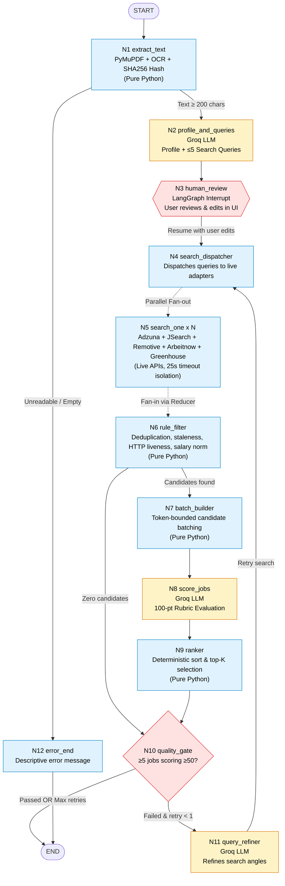

# JobPulse — AI-Powered Multi-Agent Job Recommender

> A high-performance, LangGraph-orchestrated multi-agent system that analyzes your PDF resume, constructs a verified candidate profile, searches live job boards via official APIs, applies deterministic rule filters, scores postings with Groq LLMs against a fixed 100-point rubric, and provides instant zero-token re-ranking. Fully containerized with Docker Compose.


---

## Table of Contents

1. [System Overview](#1-system-overview)
2. [Key Features](#2-key-features)
3. [Architecture and Graph Flow](#3-architecture-and-graph-flow)
4. [Node Reference](#4-node-reference)
5. [Multi-Source Search & Live Telemetry](#5-multi-source-search--live-telemetry)
6. [Multi-Stage Candidate Funnel](#6-multi-stage-candidate-funnel)
7. [Tech Stack](#7-tech-stack)
8. [Project Structure](#8-project-structure)
9. [Quickstart with Docker](#9-quickstart-with-docker)
10. [Manual Local Development](#10-manual-local-development)
11. [Configuration and Environment Variables](#11-configuration-and-environment-variables)
12. [API Reference](#12-api-reference)
13. [Quality Gate and Testing](#13-quality-gate-and-testing)
14. [License](#14-license)

---

## 1. System Overview

JobPulse transforms the job hunt from generic, keyword-stuffed search scraping into a structured, agentic intelligence pipeline:

1. **Resume Ingestion & OCR**: Extracts text from PDF resumes via PyMuPDF (with automated OCR fallback via Tesseract and Poppler for scanned documents).
2. **Profile & Query Generation**: Uses high-speed Groq inference (`llama-3.3-70b-versatile` / `qwen/qwen3.8-27b`) to synthesize an executive skill profile and formulate targeted, API-compatible search queries.
3. **Human-in-the-Loop Review**: Pauses execution via LangGraph checkpoint interrupts, allowing users to modify skills, domains, target titles, and search queries before live fetching begins.
4. **Multi-Source Live Ingestion**: Queries live APIs in parallel—**Adzuna**, **JSearch (via OpenWeb Ninja search-v2)**, **Remotive**, **Arbeitnow**, and **Greenhouse ATS**—with per-source timeout isolation and audit badges.
5. **Deterministic Rule Filtering**: Deduplicates job URLs, discards expired listings (>30 days old), validates HTTP link liveness, and normalizes salary ranges across currencies (USD/INR/EUR/GBP) without wasting LLM tokens.
6. **Structured LLM Scoring**: Evaluates candidate matches against a 100-point rubric assessing skill overlap, seniority alignment, domain relevance, and user preferences.
7. **Deterministic Re-ranking**: Enables instant sorting by Match Score, Annual Salary, or Posting Recency with **zero additional LLM calls**.
8. **Live SSE Streaming**: Streams real-time pipeline status, multi-source telemetry, and stage progress to a modern React UI.

---

## 2. Key Features

| Capability | Technical Implementation |
|---|---|
| **LangGraph Multi-Agent Graph** | StateGraph with asynchronous SQLite persistence (`AsyncSqliteSaver`), conditional branch routing, and interrupt checkpoints. |
| **Pure Groq LLM Acceleration** | Blazing-fast inference using Groq Cloud (`llama-3.3-70b-versatile` / `qwen/qwen3.8-27b`), eliminating latency bottlenecks and request timeouts. |
| **Direct API Ingestion (No Fragile Scraping)** | Replaced brittle web scrapers with structured, official job APIs (Adzuna, OpenWeb Ninja JSearch, Remotive, Arbeitnow, Greenhouse ATS). |
| **Multi-Source Audit Telemetry** | Granular status tracking per adapter (`ok (N jobs)`, `ok (0 jobs)`, `auth failed`, `rate limited`, `timeout`, `not configured`) with UI tooltip explanations. |
| **Transparent Multi-Stage Funnel** | Real-time audit metrics exposing conversion at every stage: `fetched` $\to$ `normalized` $\to$ `deduped` $\to$ `hard_filters` $\to$ `scored` $\to$ `shown`. |
| **Human-in-the-Loop Control** | Interactive modal to edit profile skills, target roles, and search queries prior to API dispatch. |
| **Deterministic Ranking & 0-Token Re-sort** | Mathematical scoring and filter algorithms in pure Python; changing salary or sorting preferences costs 0 LLM tokens. |
| **Full Dockerization** | Multi-container Docker Compose deployment with automated Nginx reverse proxying, SSE streaming, and persistent storage. |

---

## 3. Architecture and Graph Flow

### 3.1 LangGraph State Machine



---

## 4. Node Reference

| # | Node | Type | Engine | Description | LLM Calls |
|---|---|---|---|---|---|
| **N1** | `extract_text` | Python | PyMuPDF / Tesseract | Extracts clean text, enforces 6,000 char budget, computes SHA256 cache hash. | 0 |
| **N2** | `profile_and_queries` | LLM | Groq Llama 3.3 / Qwen | Synthesizes candidate skills, experience level, target titles, and API search queries. | 1 |
| **N3** | `human_review` | Interrupt | LangGraph Checkpointer | Pauses workflow so user can add/remove skills and fine-tune search queries. | 0 |
| **N4** | `search_dispatcher` | Python | Asyncio | Coordinates parallel query dispatch across all configured search adapters. | 0 |
| **N5** | `search_one` | Python | HTTP Connection Pool | Queries live job APIs (Adzuna, OpenWeb Ninja JSearch, Remotive, Arbeitnow, Greenhouse) in parallel. | 0 |
| **N6** | `rule_filter` | Python | Pure Python | Drops expired postings (>30d), deduplicates URLs, verifies HTTP status, normalizes salaries. | 0 |
| **N7** | `batch_builder` | Python | Pure Python | Packs candidate job descriptions into token-bounded batches for LLM evaluation. | 0 |
| **N8** | `score_jobs` | LLM | Groq Llama 3.3 / Qwen | Evaluates job matches against fixed 100-point rubric; extracts matched & missing skills. | 1–2 |
| **N9** | `ranker` | Python | Pure Python | Applies hard user constraints and deterministic sorting (Match, Salary, Recency). | 0 |
| **N10** | `quality_gate` | Router | Python | Evaluates candidate quality threshold (default: $\ge 5$ jobs with score $\ge 50$). | 0 |
| **N11** | `query_refiner` | LLM | Groq Llama 3.3 / Qwen | Diagnoses search failures and formulates alternative search queries (max 1 retry loop). | 0–1 |
| **N12** | `error_end` | Python | Pure Python | Emits user-friendly error diagnostics if resume extraction or processing fails. | 0 |

### Scoring Rubric Breakdown (N8)

Matches are graded deterministically against a transparent 100-point standard:
- **Skill Overlap (40 pts)**: Ratio of required skills present in candidate profile to total job requirements.
- **Seniority & Experience (25 pts)**: Alignment between candidate years of experience and role expectations.
- **Domain & Title Relevance (20 pts)**: Semantic alignment with candidate target titles and previous domains.
- **User Preference Alignment (15 pts)**: Match with work mode (Remote/Hybrid/Onsite), location, and contract type.

---

## 5. Multi-Source Search & Live Telemetry

JobPulse integrates with 5 live job data sources simultaneously:

1. **Adzuna API**: Direct country-specific search (`https://api.adzuna.com/v1/api/jobs/{country}/search`) with salary ranges and localized metadata.
2. **JSearch via OpenWeb Ninja**: Access to LinkedIn, Indeed, Glassdoor, and ZipRecruiter postings via OpenWeb Ninja's `/search-v2` endpoint with API key authentication.
3. **Remotive API**: High-quality remote tech roles from verified distributed companies.
4. **Arbeitnow API**: International and European tech positions with visa sponsorship filters.
5. **Greenhouse ATS Boards**: Direct company career postings extracted from primary enterprise ATS boards.

### Source Telemetry Audit Bar
In the UI header, each search adapter displays a real-time status badge:
- `ok (N jobs)`: Successful fetch returning $N$ candidate listings.
- `ok (0 jobs)`: API reachable and operational, but no matches for the specific query.
- `auth failed`: Invalid or missing API credentials (with tooltip indicating credential status).
- `rate limited`: HTTP 429 quota reached on provider side.
- `timeout`: Adapter exceeded the 25-second independent timeout budget.
- `not configured`: API keys not set in environment (gracefully skipped).

---

## 6. Multi-Stage Candidate Funnel

Every run tracks candidate throughput across the full pipeline. The metrics are exposed via `GET /api/runs/{run_id}/funnel` and rendered in the React interface:

```
┌────────────────────────────────────────────────────────┐
│  Candidate Ingestion Funnel Breakdown                  │
├────────────────────────────────────────────────────────┤
│  1. Fetched       : 42 raw results across all APIs     │
│  2. Normalized    : 38 successfully parsed schemas     │
│  3. Deduped       : 29 unique listings across sources  │
│  4. Hard Filters  : 23 passed age (<30d) & liveness    │
│  5. Scored        : 20 graded by Groq LLM              │
│  6. Shown         : 18 ranked and displayed in UI      │
└────────────────────────────────────────────────────────┘
```

---

## 7. Tech Stack

- **Orchestration**: LangGraph, LangChain Core, AsyncSqliteSaver
- **LLM Engine**: Groq Cloud SDK (`llama-3.3-70b-versatile`, `qwen/qwen3.8-27b`)
- **Live Search Adapters**: Adzuna API, OpenWeb Ninja JSearch, Remotive API, Arbeitnow API, Greenhouse ATS
- **Backend**: FastAPI, Uvicorn, HTTPX, Pydantic v2, sse-starlette
- **PDF & OCR**: PyMuPDF (`fitz`), Tesseract OCR, Poppler (`pdf2image`)
- **Frontend**: React 18, Vite, Tailwind CSS, Framer Motion, Lucide Icons, `@microsoft/fetch-event-source`
- **Reverse Proxy & Serving**: Nginx 1.27 Alpine (configured with SSE unbuffered streaming)
- **Containerization**: Docker & Docker Compose

---

## 8. Project Structure

```
Job-Scraper---An-AI-Agent/
├── docker-compose.yml          # Production multi-service orchestration
├── backend/
│   ├── Dockerfile              # Python 3.11-slim + OCR + Poppler backend container
│   ├── api.py                  # FastAPI server with SSE streaming & funnel routes
│   ├── config.py               # Central environment variables & startup logging
│   ├── graph.py                # LangGraph StateGraph assembly & checkpointing
│   ├── state.py                # GraphState definition & reducer functions
│   ├── schemas.py              # Pydantic v2 data models & validation
│   ├── llm.py                  # Groq client wrapper, retry logic, and fallback handling
│   ├── search.py               # Multi-source parallel search coordinator
│   ├── cache.py                # SQLite caching layer for LLM profiles and scores
│   ├── nodes/
│   │   ├── extract_text.py        # PDF text extraction & OCR fallback
│   │   ├── profile_and_queries.py # Groq candidate profiler & query planner
│   │   ├── human_review.py       # LangGraph interrupt point
│   │   ├── search_dispatcher.py  # Asynchronous fan-out dispatcher
│   │   ├── search_one.py         # Multi-adapter live API query execution
│   │   ├── rule_filter.py        # Deterministic deduping, liveness & staleness filters
│   │   ├── batch_builder.py      # Candidate batching for token-safe scoring
│   │   ├── score_jobs.py         # Groq 100-point rubric evaluation
│   │   ├── ranker.py             # Deterministic preference sorter
│   │   ├── quality_gate.py       # Threshold validator & retry router
│   │   ├── query_refiner.py      # Query diagnostic & reformulation agent
│   │   └── error_end.py          # Error handling & user messaging
│   └── tests/                  # Automated unit and acceptance test suites
├── frontend/
│   ├── Dockerfile              # Multi-stage Vite build + Nginx Alpine runtime
│   ├── nginx.conf              # Nginx proxy config with SSE buffering disabled
│   ├── index.html              # HTML entrypoint
│   ├── src/
│   │   ├── App.jsx             # Main application state and screen router
│   │   ├── api.js              # FastAPI client & SSE stream listener
│   │   ├── components/
│   │   │   ├── LandingPage.jsx     # Resume upload & preference configuration
│   │   │   ├── HumanReviewModal.jsx# Skills & search query review modal
│   │   │   ├── ProgressStepper.jsx # Real-time 9-node execution tracker
│   │   │   └── ResultsScreen.jsx   # Job cards, funnel drawer, filter controls
│   │   └── index.css           # Modern Tailwind CSS styling & glassmorphism
├── .env.example                # Template for required API keys
└── README.md
```

---

## 9. Quickstart with Docker

The fastest and most reliable way to run JobPulse is using **Docker Compose**:

### 1. Clone the repository
```bash
git clone https://github.com/ganesh-gonuguntla/Job-Scraper---An-AI-Agent.git
cd Job-Scraper---An-AI-Agent
```

### 2. Configure Environment Variables
Create your local `.env` file from `.env.example`:
```bash
cp .env.example .env
```
Edit `.env` and fill in your API credentials:
```env
# Primary LLM Engine (Pure Groq)
GROQ_API_KEY=gsk_your_groq_api_key_here

# Live Job Board Search APIs
OPENWEBNINJA_API_KEY=your_openwebninja_key_here
JSEARCH_BASE_URL=https://api.openwebninja.com/jsearch
ADZUNA_APP_ID=your_adzuna_app_id
ADZUNA_APP_KEY=your_adzuna_app_key
```

### 3. Build and Launch Containers
```bash
docker compose up -d --build
```

### 4. Access the Application
- **Frontend UI**: Open your browser at [http://localhost:5173](http://localhost:5173)
- **Backend API**: Accessible at [http://localhost:8000](http://localhost:8000) (or via Nginx reverse proxy at [http://localhost:5173/api/](http://localhost:5173/api/))
- **Health Check**: Verify operational status at [http://localhost:5173/api/health](http://localhost:5173/api/health)

To view logs or stop containers:
```bash
# Stream live logs
docker compose logs -f

# Stop containers
docker compose down
```

---

## 10. Manual Local Development

If you prefer to run services outside Docker for active code development:

### Backend Setup (Python 3.11+)

```bash
cd backend

# Create virtual environment
python -m venv .venv

# Activate virtual environment
# Windows (PowerShell):
.venv\Scripts\Activate.ps1
# macOS/Linux:
source .venv/bin/activate

# Install dependencies
pip install -r requirements.txt

# Run FastAPI with live reload
uvicorn backend.api:app --reload --port 8000
```

### Frontend Setup (Node 18+)

In a separate terminal window:
```bash
cd frontend

# Install npm packages
npm install

# Start Vite development server
npm run dev
```

The frontend will run at `http://localhost:5173` and automatically proxy API calls to `http://localhost:8000`.

---

## 11. Configuration and Environment Variables

### Environment Variables (`.env`)

| Variable | Required | Default | Description | Where to Obtain |
|---|---|---|---|---|
| `GROQ_API_KEY` | **Yes** | — | Groq Cloud API key for fast LLM inference | [console.groq.com](https://console.groq.com/) |
| `OPENWEBNINJA_API_KEY` | Recommended | — | OpenWeb Ninja key for JSearch live jobs | [openwebninja.com](https://openwebninja.com/) |
| `JSEARCH_BASE_URL` | Optional | `https://api.openwebninja.com/jsearch` | JSearch API base endpoint | [openwebninja.com](https://openwebninja.com/) |
| `ADZUNA_APP_ID` | Recommended | — | Adzuna Developer Application ID | [developer.adzuna.com](https://developer.adzuna.com/) |
| `ADZUNA_APP_KEY` | Recommended | — | Adzuna Developer Application Key | [developer.adzuna.com](https://developer.adzuna.com/) |
| `ADZUNA_COUNTRY` | Optional | `us` | Default country code for Adzuna searches | Adzuna documentation |
| `MOCK_LLM` | Optional | `false` | Run with fixture data (0 API tokens consumed) | Local toggle |

> [!NOTE]
> Public ATS sources (**Remotive**, **Arbeitnow**, and **Greenhouse**) do not require API keys and function out-of-the-box.

---

## 12. API Reference

### Endpoints

| Method | Endpoint | Description |
|---|---|---|
| `POST` | `/api/runs` | Accepts `pdf` file (multipart) and `preferences` JSON; initializes graph and returns `run_id`. |
| `GET` | `/api/runs/{run_id}/stream` | Server-Sent Events (SSE) stream delivering real-time node transitions, logs, and results. |
| `POST` | `/api/runs/{run_id}/resume` | Submits user-approved modifications during the human review interrupt to resume execution. |
| `POST` | `/api/runs/{run_id}/rerank` | Accepts modified `preferences` JSON; re-sorts scored jobs deterministically (**0 LLM tokens**). |
| `GET` | `/api/runs/{run_id}/funnel` | Returns the multi-stage conversion funnel breakdown for the specified run. |
| `GET` | `/api/health` | Diagnostic endpoint checking LLM and live search adapter connectivity. |

### SSE Event Stream Types

- `node_start`: Emitted when an execution node starts processing (e.g., `{"node": "rule_filter"}`).
- `node_end`: Emitted upon node completion with summary metrics (e.g., `{"node": "rule_filter", "summary": "Filtered to 18 jobs"}`).
- `interrupt`: Pauses execution with extracted profile and queries for user review.
- `audit_statuses`: Real-time operational statuses for each search adapter.
- `result`: Emitted when execution concludes, delivering final scored jobs and status notes.
- `error`: Emitted in case of unrecoverable failures.

---

## 13. Quality Gate and Testing

JobPulse includes an automated acceptance test suite verifying end-to-end reliability:

```bash
cd backend
python -m pytest tests/
```

### Acceptance Test Coverage
- **End-to-End Pipeline**: Verifies that standard resumes (e.g. Data Analyst, Full-Stack Developer) yield $\ge 15$ verified postings with $\ge 5$ scores $\ge 50$.
- **HTTP Link Liveness**: Confirms all emitted job links return HTTP 200/30x status.
- **Absurd Query Safety**: Verifies that nonsense or zero-match criteria gracefully trigger the quality gate refiner without crashing or outputting hallucinations.
- **Funnel Metric Integrity**: Asserts that `fetched \ge normalized \ge deduped \ge hard_filters \ge scored \ge shown`.

---

## 14. License

Released under the [MIT License](LICENSE).
